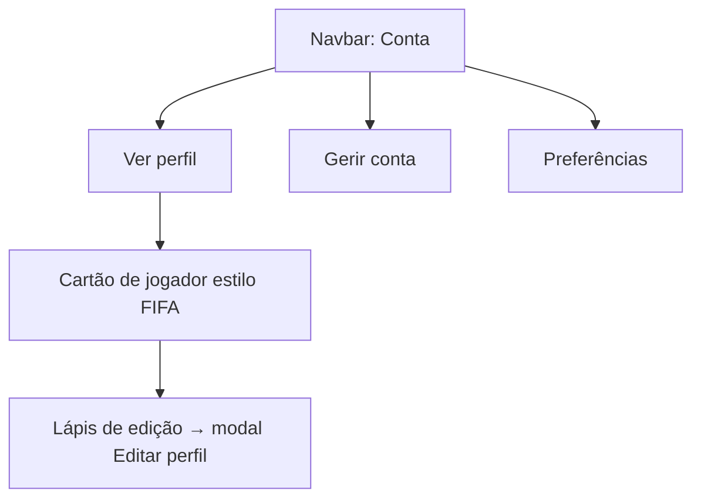

# Épico da conta do jogador

**Estado:** MVP acordado · pronto para planear a implementação.

- [Cartão do jogador](player-card.md): perfil visível para a comunidade e cartão partilhável.
- [Gestão da conta](account-management.md): identidade e eliminação da conta.
- [Preferências de email](email-preferences.md): notificações opcionais sobre jogos.
- [MVP acordado](player-account-mvp.md): âmbito final e critérios de aceitação.

Os dados públicos do perfil, os dados privados da conta e as preferências de notificações devem permanecer separados.
