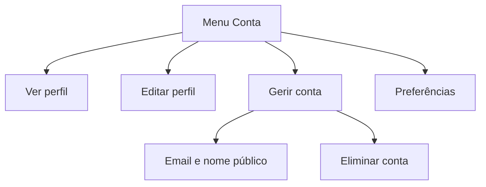

# Gestão da conta

**Estado:** MVP acordado

Um menu compacto disponibiliza **Ver perfil**, **Editar perfil**, **Gerir conta** e **Preferências**. O lápis do cartão abre o mesmo fluxo de **Editar perfil**.

**Gerir conta** permite alterar o email e o nome público, assim como eliminar a conta através de uma confirmação explícita e irreversível. O email permanece privado. O MVP não introduz um `@username` único separado.

Eliminar uma conta remove o acesso e os dados públicos do perfil. Os jogos históricos mantêm uma presença anónima quando necessário para preservar os registos, sem identificar ou manter uma ligação ao jogador eliminado.
