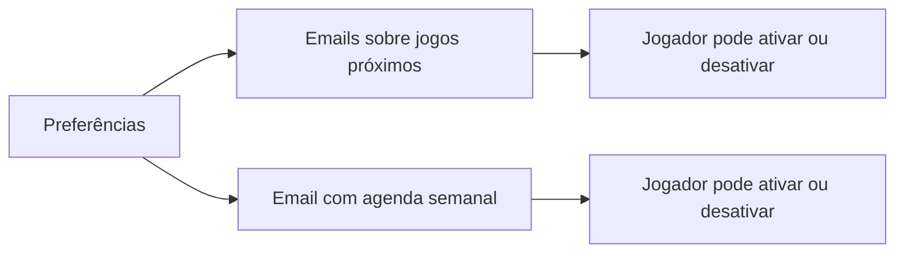

# Preferências de email

**Estado:** MVP acordado

O jogador pode ativar separadamente:

- Emails quando forem agendados jogos perto da sua zona preferida.
- Um email semanal com os jogos em que está inscrito.

Cada preferência pode ser desativada de forma independente. Os emails devem incluir ligações para a aplicação e para a gestão das preferências.

As duas preferências começam desativadas e exigem consentimento explícito. A definição de “próximo” usa a zona preferida do jogador. O email semanal usa o fuso horário do jogador e inclui apenas os jogos da semana seguinte em que está inscrito.
