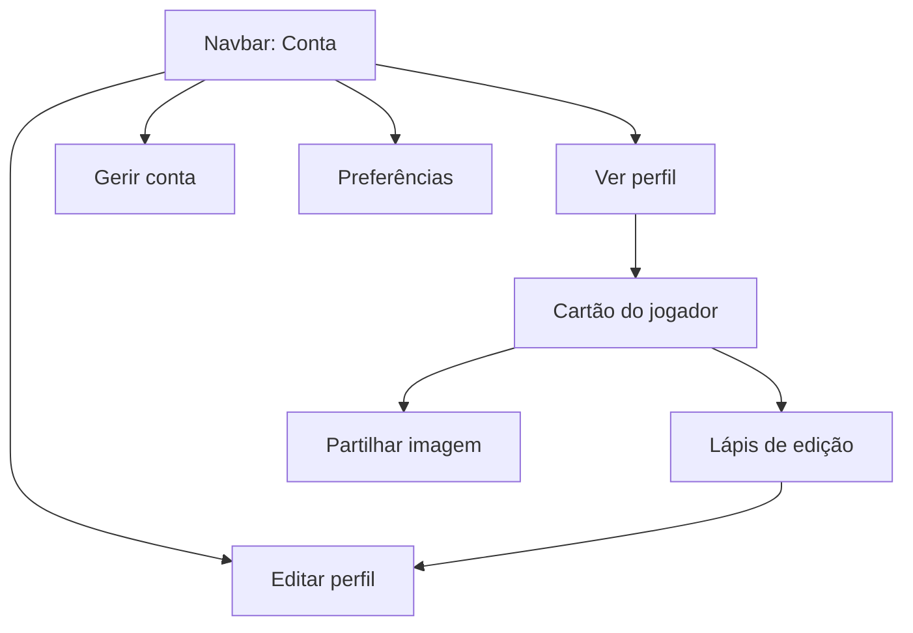

# MVP da conta do jogador

**Estado:** Acordado · âmbito final para a primeira implementação.

## Jornada do utilizador

## Incluído

1. Navegação da conta com **Ver perfil**, **Editar perfil**, **Gerir conta** e **Preferências**.
2. Edição da fotografia, nome público, data de nascimento, zona preferida e posição preferida.
3. Um cartão com fotografia, nome público, idade calculada, zona preferida, posição, jogos disputados e badge de fundador quando aplicável.
4. Jogos disputados calculados a partir das presenças confirmadas.
5. Uma imagem própria para Instagram contendo apenas os dados públicos do cartão.
6. Gestão do email e nome público, assim como eliminação confirmada da conta.
7. Preferências independentes e opcionais para emails sobre jogos próximos e a agenda semanal.

## Responsabilidade pelos dados

| Dados | Controlados por |
|---|---|
| Fotografia, nome público, data de nascimento, zona e posição preferidas | Jogador |
| Badge de fundador | Sistema |
| Jogos disputados | Presenças confirmadas nos jogos |
| Preferências de email | Jogador |

## Critérios de aceitação

- Um jogador autenticado pode ver e editar o seu perfil através do menu da conta ou do lápis no cartão.
- Outros jogadores autenticados podem ver o perfil; o MVP não inclui um URL público para o perfil.
- A data de nascimento e o email nunca aparecem no cartão nem na imagem partilhada.
- As imagens partilhadas contêm os dados atuais do perfil e a identidade visual do produto.
- O jogador não pode editar o estado de fundador nem o número de jogos disputados.
- As duas preferências de email começam desativadas e podem ser alteradas separadamente.
- A eliminação da conta remove o acesso e os dados identificativos do perfil após confirmação explícita.
- Todo o novo conteúdo da interface está disponível em português e inglês.

## Mais tarde

- Golos, assistências, desempenho por jogo e verificação pelo criador.
- Perfis públicos, classificações, avaliações, conquistas, elogios, seguidores e ligações a redes sociais.
- Privacidade configurável por campo do perfil e apresentação da idade por intervalos.
