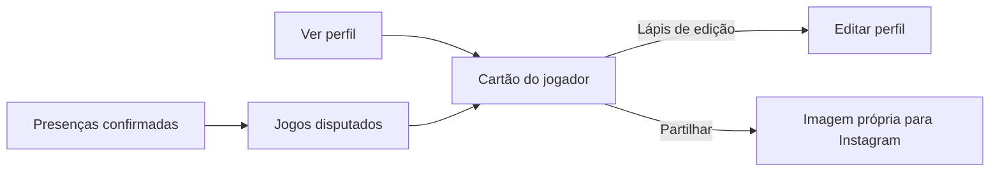

# Cartão do jogador

**Estado:** MVP acordado

O jogador autenticado pode ver e editar o seu cartão. O cartão apresenta:

- Fotografia, zona preferida, idade calculada, posição preferida e jogos disputados.
- Um badge de fundador quando o produto identifica o jogador como fundador.

Os perfis são visíveis para membros autenticados da comunidade. A partilha é uma ação explícita que produz uma imagem própria para Instagram; não cria um URL público para o perfil. A imagem inclui apenas os campos do cartão e nunca expõe a data de nascimento, o email ou dados da conta.

O jogador edita a data de nascimento, mas o produto apresenta apenas a idade calculada. O estado de fundador e o número de jogos disputados são controlados pelo sistema.

Os golos e as assistências ficam fora deste MVP. As estatísticas futuras pertencem a jogos individuais, começam como declaradas pelo próprio jogador e poderão mais tarde ser verificadas pelo criador do jogo.
